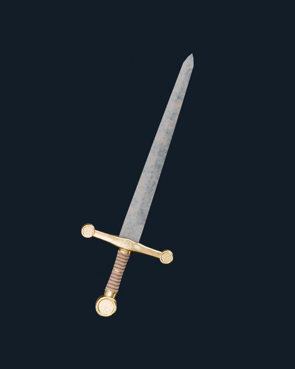
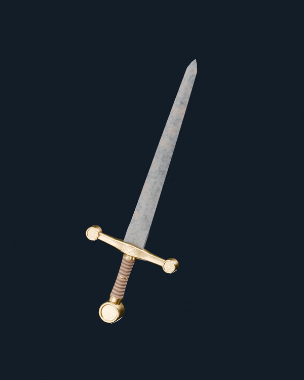
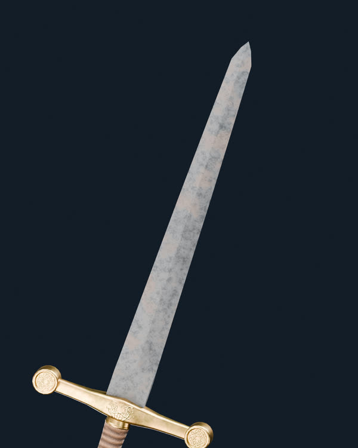

# Project Genesis — Render base maestro de la espada V03 / hierro V175

**Candidato experimental para evaluación visual. No aprobado ni integrado en `main`.**

Esta galería es un **render auténtico de Blender 4.5.13 LTS, Cycles, con HDRI EXR RGB de 32 bits por canal** (Studio Small 09, 4096 × 2048). Utiliza exactamente el GLB V03 preexistente de 2.150 triángulos y su material de hierro V175 sin modificar geometría, normales, UV ni PBR.

## 1. Espada completa · vista frontal

[Ver render frontal completo en PNG](V03_Blender_Cycles_HDRI32_Hero.png)

## 2. Espada completa · tres cuartos

[Ver render de tres cuartos completo en PNG](V03_Blender_Cycles_HDRI32_TresCuartos.png)

## 3. Acercamiento a hoja y filo

[Ver detalle del filo completo en PNG](V03_V175_HDRI32_Detalle_Filo.png)

## Perfil maestro para los siete canales

- [Configuración reproducible de iluminación, cámara y exposición](lighting_profile.json)
- [Auditoría de material, HDRI, malla y renders](render_audit.json)
- Geometría base intacta; efectos elementales desactivados.
- El EXR permanece como fuente de iluminación del render, **no se sustituye por JPG ni PNG**.
- Los renders PNG son **salidas de visualización**, no la fuente HDRI. Las miniaturas JPG de esta página son derivadas del render PNG para revisión móvil, **no se utilizan como iluminación ni como texturas PBR**.

La siguiente fase consiste en usar esta referencia para evaluar los canales **de forma individual** y guardar sus valores y presencia en JSON. Hasta la aprobación visual de la espada base, no se retocan los efectos.
