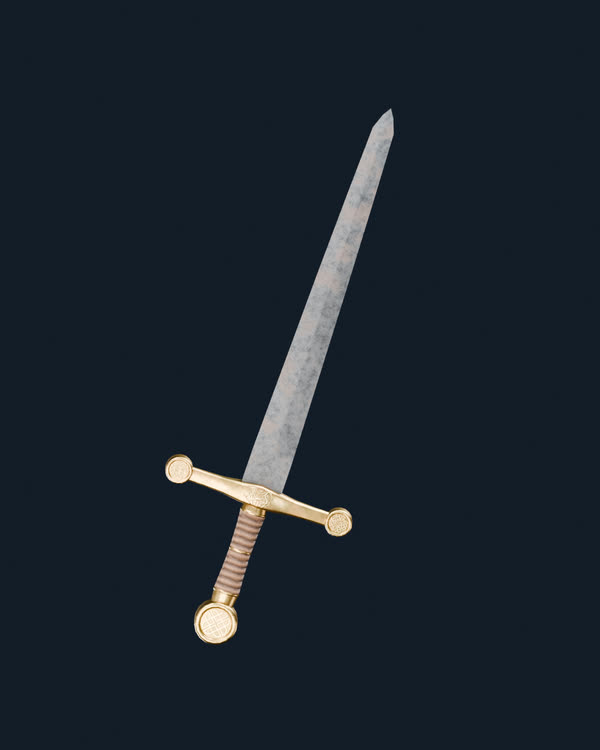
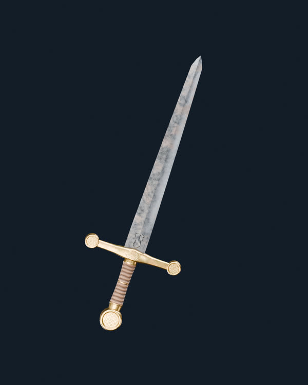
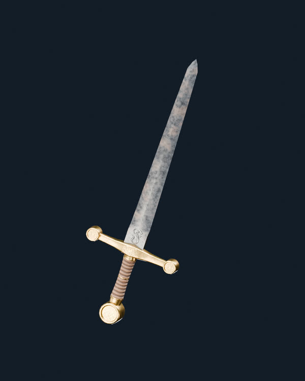
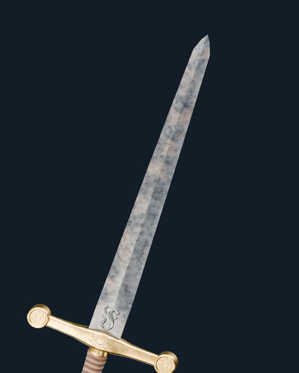

# Project Genesis — V11 · hierro V175 con nervio J restaurado

**Comparación real de Blender Cycles, HDRI EXR 32 bits/canal, sin VFX.** Ninguna variante de V11 está aprobada todavía.

La V10 tenía el color correcto pero el nervio y el filo aparecían demasiado mates. Esta V11 **mantiene exactamente el nodo que suministra el color V175 de la V10** y prueba la respuesta del material de la antigua candidata **J**:
- Mapa normal original de Fab, que devuelve microrelieve y lectura longitudinal del nervio.
- Rugosidad original de V175 × 0,49 y metal del mapa Fab con mínimo 0,98.
- Franja rectangular de luz reflejada, sin Emissive ni geometría nueva.
- HDRI EXR Studio Small 09 de 4096 × 2048, 32 bits por canal RGB, SHA-256 verificado.

## Referencia V10 — buen color, reflejo insuficiente

## V11 — mismo color V175, normales Fab y reflejo sobre nervio

[Imagen completa](V11_V175_Color_Original_J_Nervio_Hero.png)

## V11 — vista tres cuartos

[Imagen completa](V11_V175_Color_Original_J_Nervio_TresCuartos.png)

## V11 — acercamiento al filo y nervio

[Imagen completa](V11_V175_Color_Original_J_Nervio_Filo_Detalle.png)

## Comparativa: franja reflejada un poco más intensa (solo iluminación)

[Imagen completa](V11_V175_Color_Original_J_Nervio_Strip145_Hero.png)

**Auditoría:** [v11_surface_audit.json](v11_surface_audit.json) · [perfil maestro HDRI](lighting_profile.json).

Esta no es una reconstrucción de la J exacta: retiene deliberadamente el color que gustó en V10, recuperando el tratamiento de normals/metal/roughness de J y su luz lineal. La J histórica además mezclaba la pátina V175 con una calibración tonal 0,72. La geometría original de 2.150 triángulos y los shaders elementales se mantienen sin cambios.
