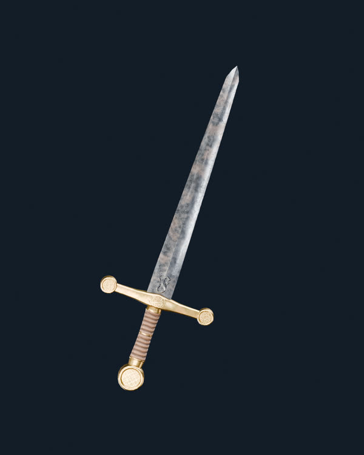
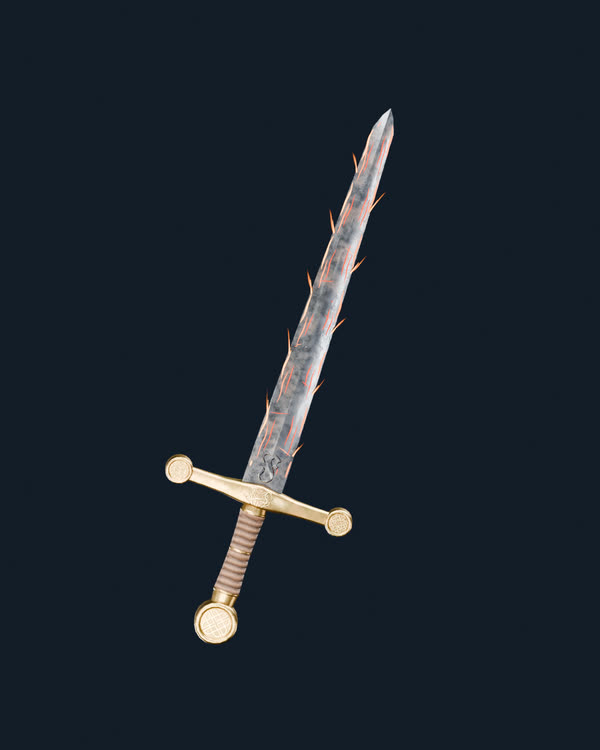
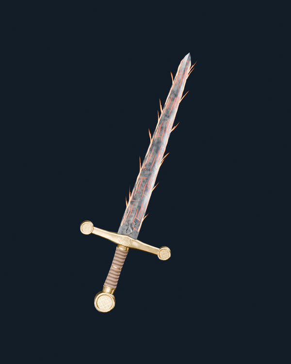
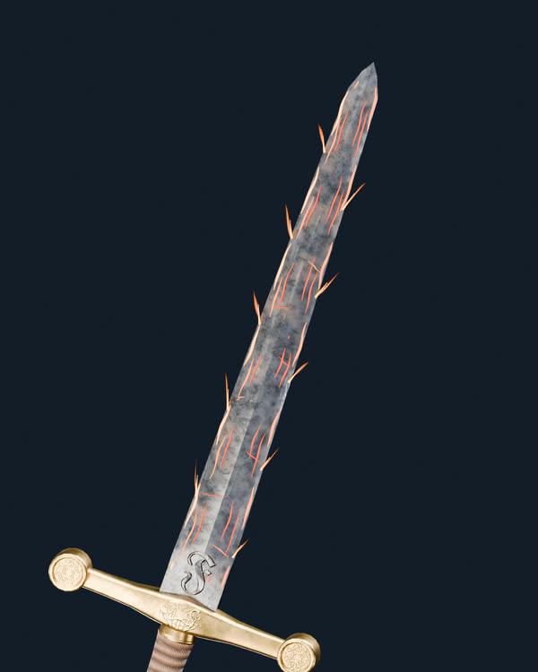

# Project Genesis · Fuego V02 sobre espada REAL V12B (Blender Cycles)

**V14 EXPERIMENTAL — evaluación visual pendiente.** Estas son imágenes renderizadas usando el GLB ORIGINAL de la espada V03 (2.150 triángulos), el hierro V175 con el preset **V12B aprobado**, y un HDRI EXR **de 32 bits por canal RGB**. Sin imágenes generadas, concepts, ni modificación del asset base.

## Base aprobada: V12B sin fuego

[Render base V12B a resolución completa](V12_V175_Color_J_Rugosidad034_Hero.png)

## Fuego V02 intensidad 60

[Render real Fuego V02 a 60](Fuego_V02_060_V12B_Hero.png)

## Fuego V02 intensidad 100

[Render real Fuego V02 a 100](Fuego_V02_100_V12B_Hero.png)

## Acercamiento al filo, intensidad 60

[Render macro real](Fuego_V02_060_V12B_Detalle_Filo.png)

## Cambios frente a Fuego V01/V13
- Retiradas las luces puntuales responsables de manchas redondas naranjas.
- Vetas rojas y naranjas que siguen el hierro real, sin líneas blancas.
- Lenguas de fuego con geometría de tira translúcida que **nacen del borde real de la hoja**.
- A intensidad 100 hay más vetas y llamas; no es simplemente el mismo efecto aumentando exposición.
- Sin reemplazar el color, normales, rugosidad, metal o geometría aprobada de la V12B.

**Precisión técnica:** Este render es una previsualización REAL de Blender Cycles de la estética del módulo Fuego V02 (curvas emisivas + geometría de llama). NO implica que el módulo GLSL PlayCanvas V01 sea el mismo ni que ya esté actualizado. Su implementación PlayCanvas quedará independiente y necesita prueba WebGL2 después de la evaluación visual.

[Presets base V12B guardados](../../presets/approved/Genesis_Espada_V03_Hierro_V175_V12B.json) · [Auditoría del render](fuego_v02_real_v12b_audit.json)

**Sin cambios en `main` ni en el modelo maestro.**
