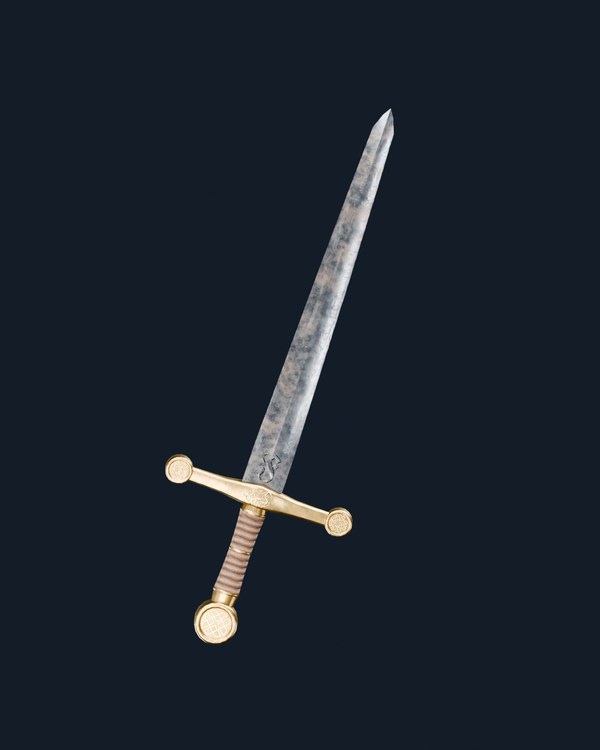
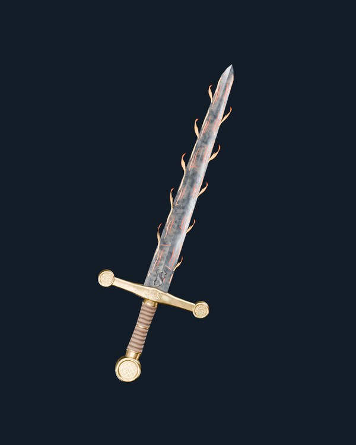
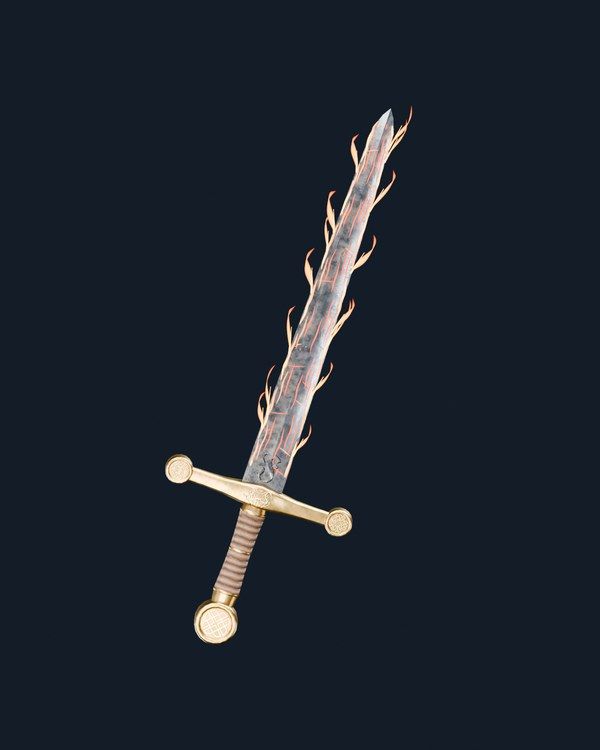
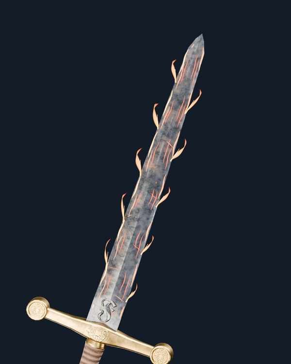

# Project Genesis — Fuego V03 · espada real V175 / V12B

**V15: candidato visual experimental.** No se utilizan conceptos ni modelos sustitutos. Se renderiza el GLB original de 2.150 triángulos de la espada V03 con los materiales V175 y el preset **V12B aprobado**, Blender Cycles, HDRI Studio Small 09 EXR de 32 bits RGB/canal, 96 muestras.

## Hierro V12B original, sin fuego

## Fuego V03 intensidad 60

[Ver render 1200 × 1500](Fuego_V03_060_V12B_Hero.png)

## Fuego V03 intensidad 100

[Ver render 1200 × 1500](Fuego_V03_100_V12B_Hero.png)

## Detalle del hierro y llamas de filo a 60

[Ver render macro completo](Fuego_V03_060_V12B_Detalle_Filo.png)

## Correcciones respecto de la V14

- Fuego V03 mantiene las vetas de brasas rojizas **adheridas a la malla real**.
- Las llamas son superficies emisivas translúcidas más anchas, con gradiente naranja/rojo y extremos curvados, no púas rectas.
- La intensidad 100 aumenta el número y el cuerpo de las llamas, sin reemplazar el metal.
- No se agregan luces puntuales que fabriquen manchas redondas.
- El material y los parámetros aprobados V12B permanecen intactos.
- Los efectos son geometría extra independiente durante el render, no cambios en el GLB original.

**Precisión:** esto es una prueba visual de Fuego V03 traducida a mallas y materiales emisivos **Blender Cycles**, no el shader GLSL original ejecutado en PlayCanvas. La versión de shader de juego sigue necesitando validación independiente tras aprobación visual.

[Auditoría](fuego_v03_real_v12b_audit.json) · [Preset original aprobado](../../presets/approved/Genesis_Espada_V03_Hierro_V175_V12B.json)

Ninguna modificación a `main`.
