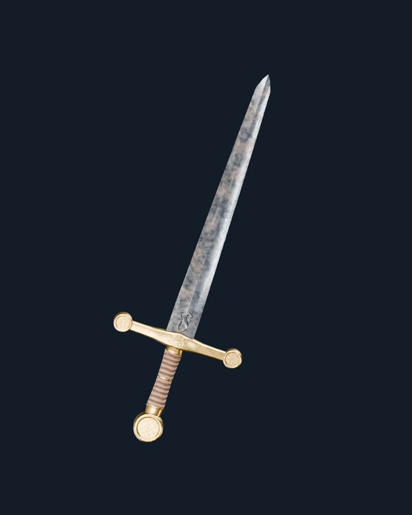
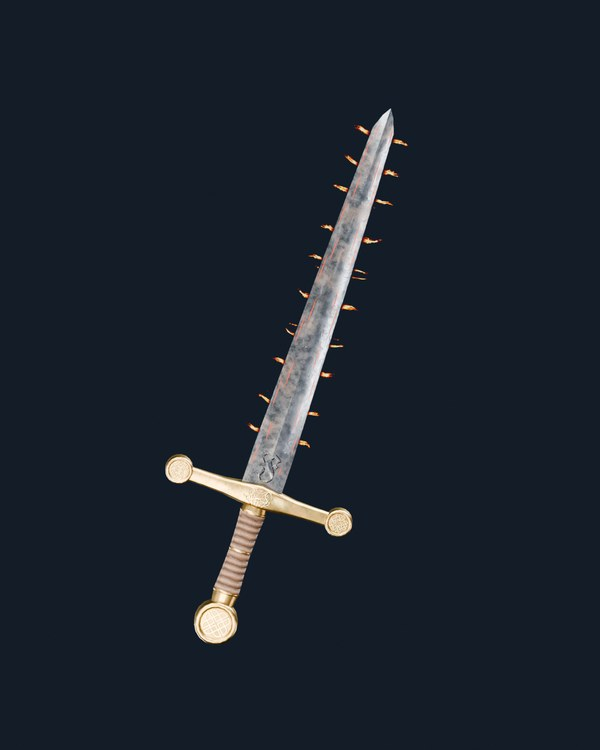
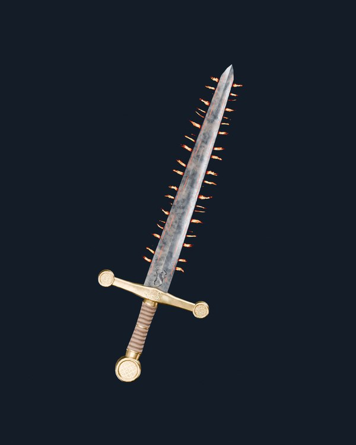
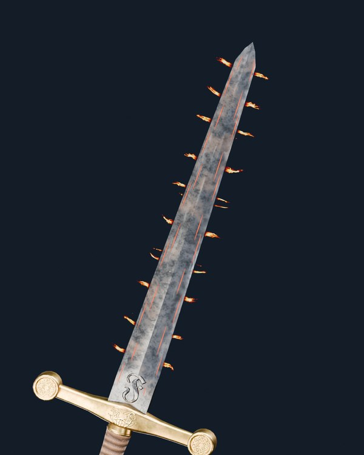

# Project Genesis — Fuego V04 con llama REAL (Unity Labs CC0) · espada V12B

**Esta es una prueba de render 3D real en Blender Cycles sobre la espada V03 ORIGINAL, con hierro V175–V12B aprobado. Sin concepts ni imágenes generadas.**

## Hierro V12B original · Sin fuego

## Fuego V04 intensidad 60/100

[Ver render 60 completo](Fuego_V04_060_V12B_Hero.png)

## Fuego V04 intensidad 100/100

[Ver render 100 completo](Fuego_V04_100_V12B_Hero.png)

## Detalle del filo V12B + Fuego V04

[Ver render detalle completo](Fuego_V04_060_V12B_Detalle_Filo.png)

## Qué cambia respecto de las llamas rígidas V15
- Se utilizan **cuadros reales de una llama animada** de Unity Labs Paris, específicamente el atlas `SmallFlame01-mini`, en vez de inventar mallas puntiagudas.
- Fuente de llama: `SmallFlame01-mini_16x4.exr` HDR + `SmallFlame01-mini_16x4.tga` RGBA, **64 fotogramas**, con licencia **CC0**.
- Los sprites de fuego se anclan físicamente a los bordes y orientación de la hoja original: se evalúan sus **98 triángulos reales**, sin sustituir la espada.
- Cada sprite toma un fotograma distinto; una futura versión PlayCanvas podrá reproducir el flipbook animado.
- 60 y 100 tienen diferente cantidad, tamaño y opacidad. Las brasas del metal son elementos independientes.
- HDRI de iluminación: Studio Small 09, archivo EXR RGB de **32 bits por canal** (distinto de las texturas de fuego).
- Material de hierro V12B **no modificado**; Fuego es una capa VFX, no un reemplazo de textura.
- `main` y la versión aprobada quedan intactos.

## Fuentes, licencia y precisión técnica
- [Fuente oficial de Unity Labs: secuencias y flipbooks CC0](https://unity.com/blog/engine-platform/free-vfx-image-sequences-flipbooks)
- [Atlas SmallFlame01-mini original](https://unity3d.com/files/labs/downloads/vfx/assets01/SmallFlame01-mini-temperature/SmallFlame01-mini-flipbooks.zip)
- [Preset hierro V12B](../../presets/approved/Genesis_Espada_V03_Hierro_V175_V12B.json)
- [Auditoría real Cycles, fuentes y hashes](fuego_v04_cc0_real_v12b_audit.json)

**Esta es una prueba Blender Cycles del look visual, no significa que el shader de Fuego V04 en PlayCanvas ya esté implementado o aprobado.** Necesita revisión del usuario y luego una prueba WebGL2.
