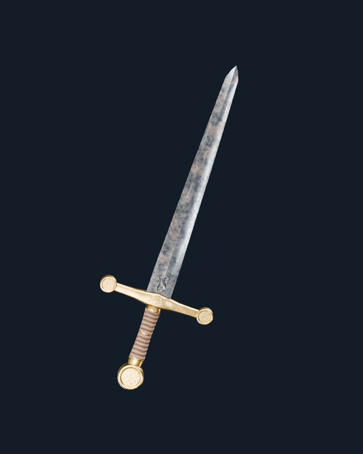
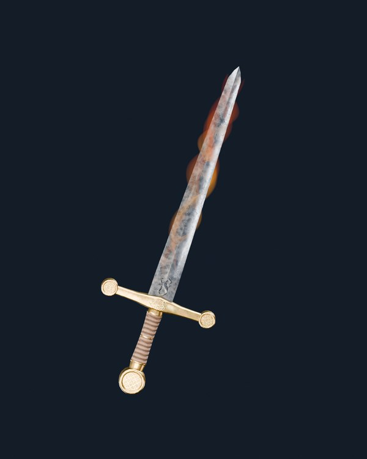
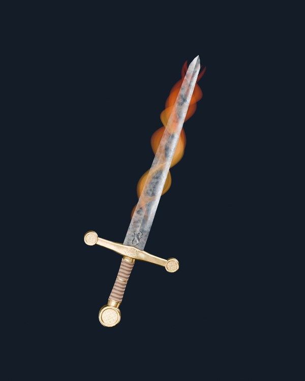
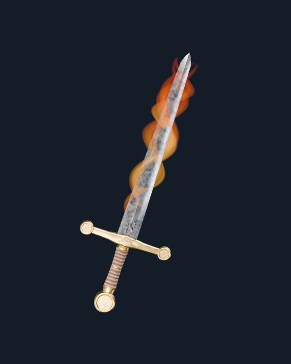
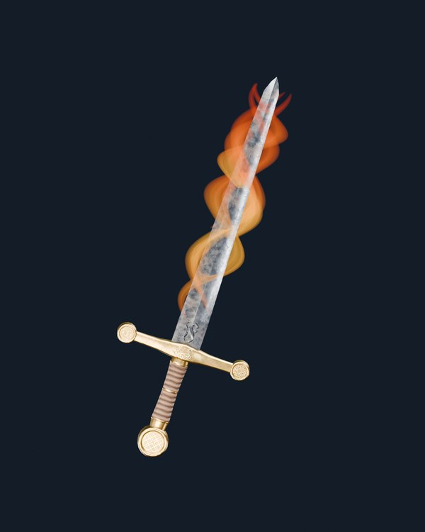
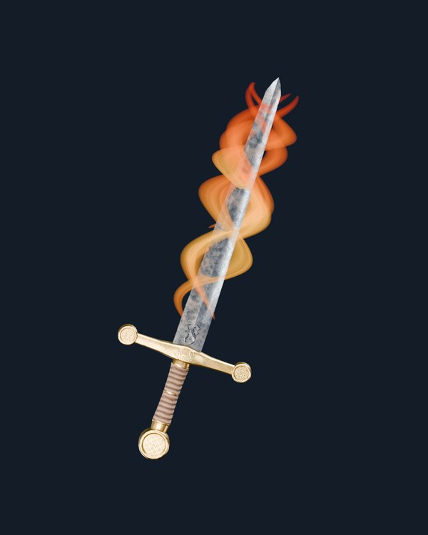

# Project Genesis — Fuego V05 elegante, fluido y controlado · V17

**Render real de Blender Cycles, no concept.** Esta propuesta sigue la referencia visual aportada por el usuario: llamas ascendentes, fluidas, envolventes, **sutiles y sobrias**, con movimiento largo en S y sin pequeñas chispas alineadas. La espada no es la de la referencia: se conserva la **espada V03 original con hierro V175–V12B aprobado**.

Se emplean **cuatro velos continuos** que se curvan por delante y detrás de la hoja. Cada uno utiliza fotogramas y transparencia del atlas **real Unity Labs CC0 SmallFlame01-mini** como detalle de movimiento y opacidad. Su silueta serpenteante acompaña la geometría real de 98 triángulos de la hoja. El metal V12B permanece visible.

## Comparación real de intensidad continua: 0–100

| Intensidad | Captura real 1200 × 1500 |
|---|---|
| **0 / 100** |  |
| **25 / 100** |  |
| **50 / 100** |  |
| **60 / 100** |  |
| **75 / 100** |  |
| **100 / 100** |  |

[Ver vista macro a intensidad 60](Fuego_V05_060_V12B_Detalle_Filo.png).

La **intensidad es un escalar continuo entre 0 y 100**, sin niveles discretos ni aparición progresiva de cada tira. Al aumentar, cambian de forma gradual el ancho, las ondas y la transparencia de los mismos cuatro velos. A 0 se devuelve la escena original sin VFX, y en la prueba a intensidad 100 hay exactamente cuatro velos (no 32 llamitas repetidas).

**Fuentes:** [VFX Unity Labs CC0](https://unity.com/blog/engine-platform/free-vfx-image-sequences-flipbooks) · [ZIP original SmallFlame01-mini](https://unity3d.com/files/labs/downloads/vfx/assets01/SmallFlame01-mini-temperature/SmallFlame01-mini-flipbooks.zip).

Se verifican el SHA original de GLB V03, HDRI Studio Small 09 **EXR de 32 bits por canal**, y los valores aprobados de rugosidad V12B 0.34 / óxido local 0.10. Para el fuego se utiliza el TGA RGBA original: la versión EXR del flipbook no se decodifica en Blender 4.5.13. El HDRI de 32 bits de iluminación es independiente y permanece idéntico.

[Auditoría de rendereo](fuego_v05_fluid_real_v12b_audit.json).

**Experimental, evaluación visual humana pendiente. No se editó `main`, no se modificó el GLB original, ni se afirmó que la versión de juego GLSL/WebGL2 esté implementada.**
