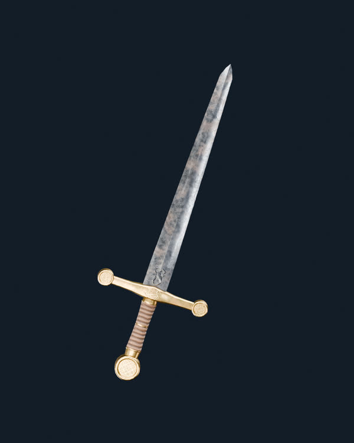
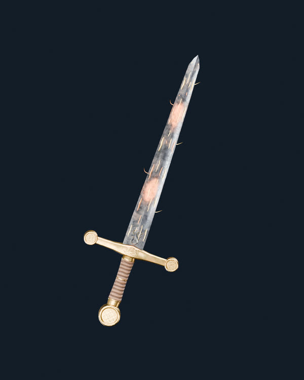
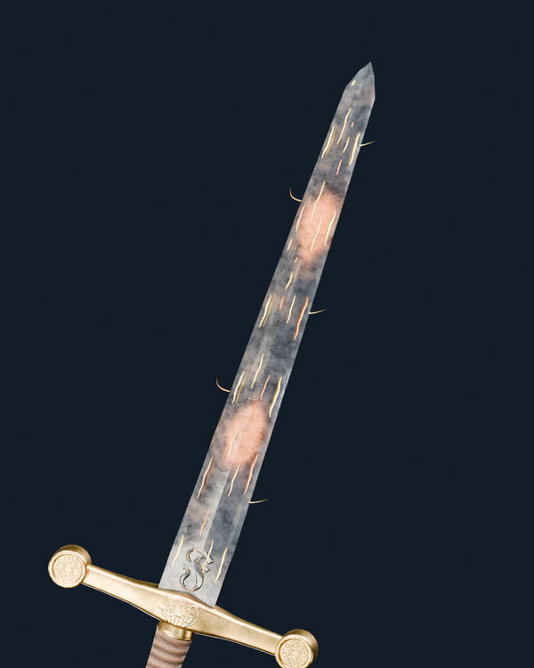

# Project Genesis — Fuego sobre espada de hierro V12B (RENDER REAL)

**Esta página muestra renders reales de Blender Cycles del GLB original de espada V03, con el preset de hierro V175 V12B que aprobó el usuario.** No se generaron conceptos ni se reemplazó la espada.

## 0. Espada V12B aprobada, sin efectos

[Ver PNG original completo](V12_V175_Color_J_Rugosidad034_Hero.png)

## 1. Fuego 60/100 sobre la hoja V175 V12B

[Ver render Cycles completo](Fuego_060_V12B_Hero.png)

## 2. Fuego 100/100, misma hoja y HDRI

[Ver render Cycles completo](Fuego_100_V12B_Hero.png)

## 3. Detalle de hierro, filo y Fuego 60

[Ver detalle completo](Fuego_060_V12B_Detalle_Filo.png)

**Tecnología y límites de la prueba:** Blender 4.5.13 LTS, Cycles 96 muestras, Studio Small 09 EXR RGB de 32 bits/canal y material hierro V12B inalterado. La geometría del Fuego se crea como curvas emisivas independientes, calculadas sobre las 98 caras trianguladas de la hoja original; respeta el patrón de las cuatro vetas del módulo Fuego V01. Esta prueba es una **traducción real 3D en Blender** de la presentación del efecto, **no una ejecución del shader GLSL original de PlayCanvas**, que debe validarse después por separado. El color V175 y el GLB jamás se reexportan.

- [Preset aprobado V12B con materiales e iluminación](../../presets/approved/Genesis_Espada_V03_Hierro_V175_V12B.json)
- [Auditoría técnica y capturas](fuego_real_v12b_audit.json)
- [Comparativa V12B previa](../espada-v175-j-roughness-v12/README.md)

**Fuego: candidato experimental no aprobado visualmente.** Ninguna integración a `main`.
