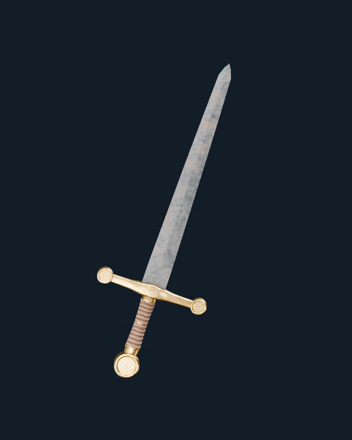
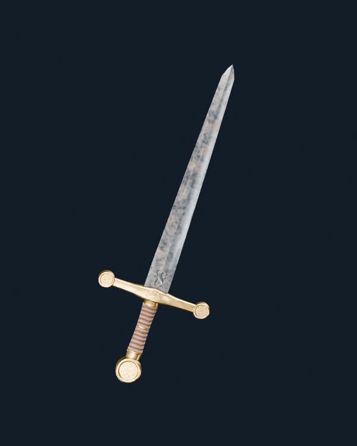
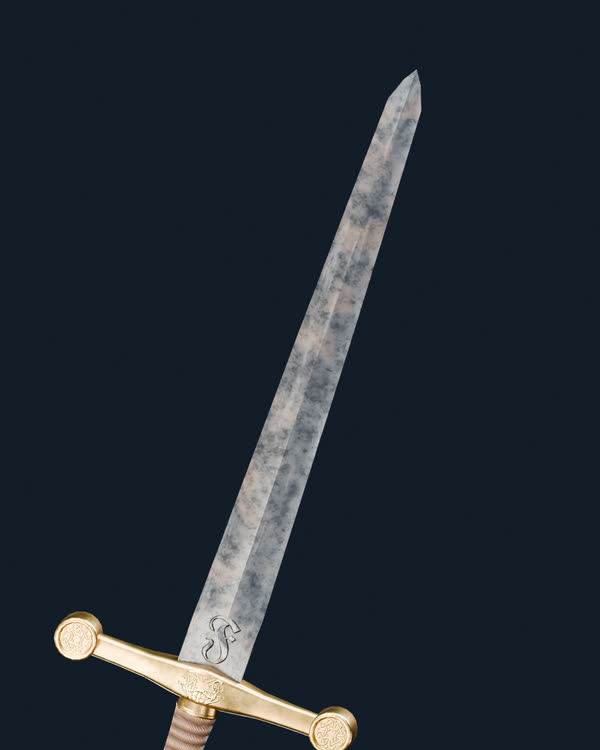
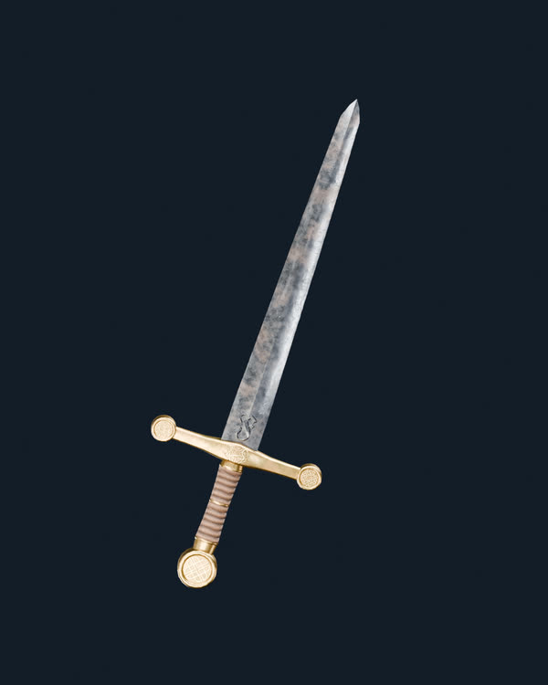
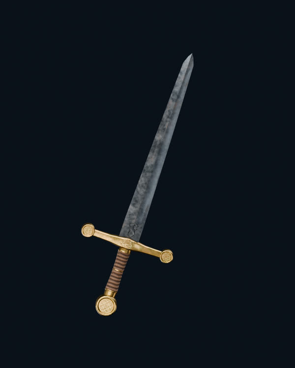

# Project Genesis — V12: Nervio y filo con rugosidad localizada J, color V175 V10 intacto

**Candidato experimental pendiente de aprobación visual.** El objetivo es resolver el defecto señalado: el hierro V10 conservaba buen color, pero perdió reflejo en el nervio central y en los filos.

Misma espada original V03 de 2.150 triángulos, mismas cámaras, HDRI EXR Studio Small 09 (32 bits por canal), Blender 4.5.13 LTS, Cycles con 96 muestras. Nada se exporta al GLB maestro.

## Referencia V10: color correcto, reflejo apagado

## V12-A: J — brillo limpio + rugosidad de óxido localizada

[Ver resolución completa](V12_V175_Color_J_Rugosidad042_Hero.png)

## Vista macro del filo y nervio en V12-A

[Ver detalle completo](V12_V175_Color_J_Rugosidad042_Detalle_Filo.png)

## V12-B: hierro más pulido con la misma paleta

[Ver resolución completa](V12_V175_Color_J_Rugosidad034_Hero.png)

## J histórica — referencia exacta, más oscura

La J histórica mezclaba una pátina y oscurecía la paleta. La V12 **no cambia la base de color V10**; modifica solo el aspecto físico de la hoja: normales Fab, metal Fab, rugosidad V175 y contraste local de óxido.

[Detalles reproducibles de las dos variantes](v12_surface_audit.json) · [HDRI original y luces](lighting_profile.json).

No hay shaders de Fuego, Rayo ni otros canales en estos renders. `main` y los assets aprobados permanecen intactos.
