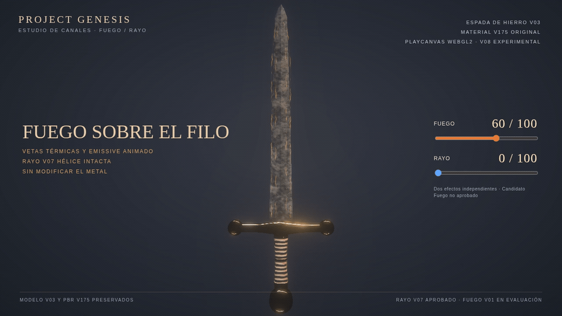
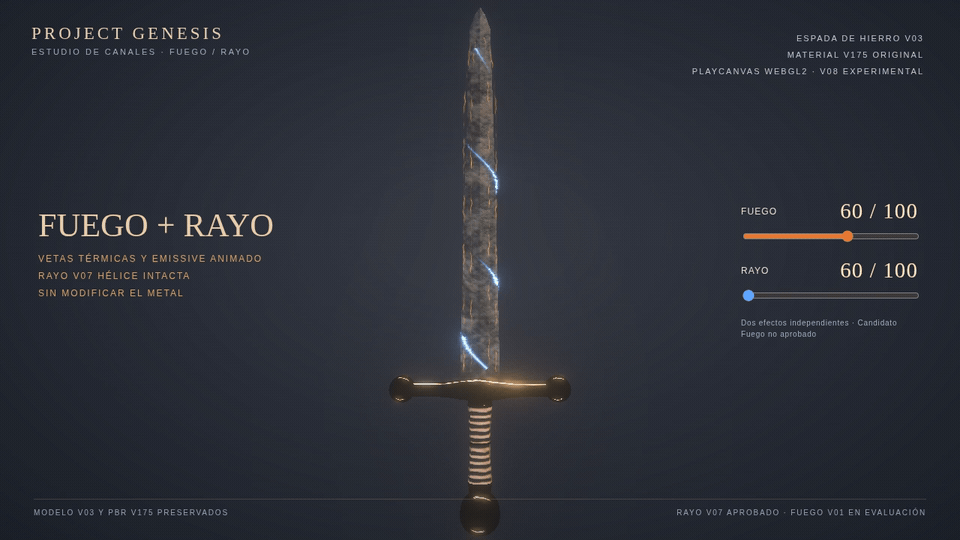
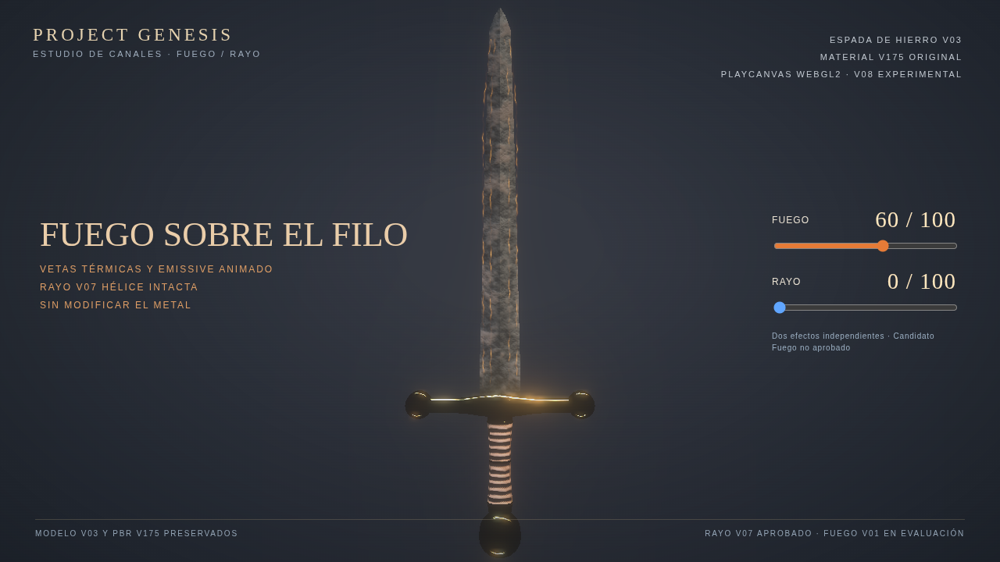
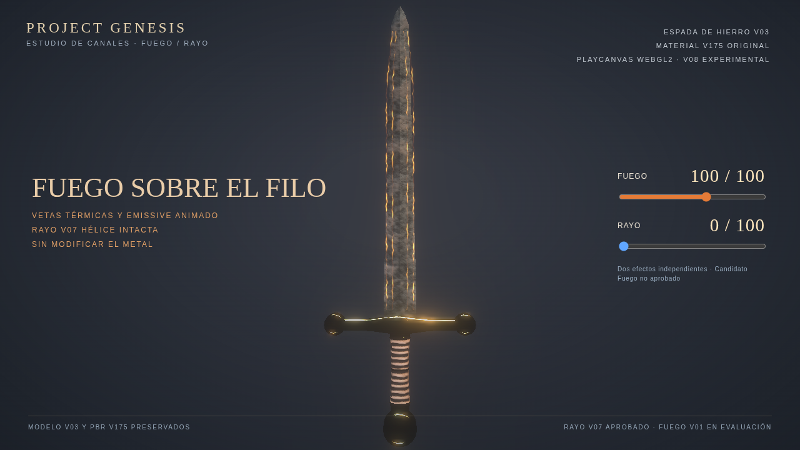
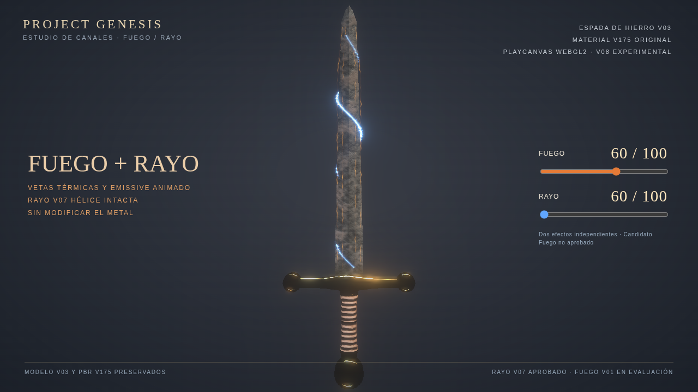

# Project Genesis — V08 Fuego sobre el filo + Rayo V07 aprobado

Prueba real de PlayCanvas WebGL2 con dos shaders independientes. **El Fuego y las combinaciones no están aprobados**.

El Rayo V07 aprobado no se modifica; se verifica su GLSL byte por byte contra el original. La espada V03 y el material V175 permanecen intactos.

## Fuego solo — vetas sobre ambos filos

[Video Fuego 60/100](Fuego_060.mp4) · [Video Fuego 100/100](Fuego_100.mp4)

## Combinación Fuego + Rayo

[Video Fuego 60 + Rayo 60](Fuego060_Rayo060.mp4) · [Video Fuego 40 + Rayo 80](Fuego040_Rayo080.mp4)

## Comparación de un mismo instante de la animación

| Fuego 60 / Rayo 0 | Fuego 100 / Rayo 0 | Fuego 60 / Rayo 60 |
|---|---|---|
|  |  |  |

Auditoría: [audit.json](audit.json). Rayo V07 aprobado visualmente pero no integrado. Fuego V01 experimental: no aprobado.

PlayCanvas usa el perfil de estudio anterior y bloom HDR de cámara para comparar versiones; esta vista no es un render Blender Cycles con HDRI EXR. No se distribuye el GLB original.
