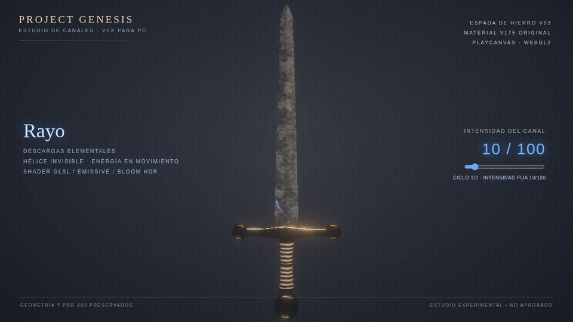
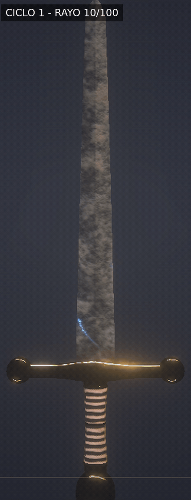
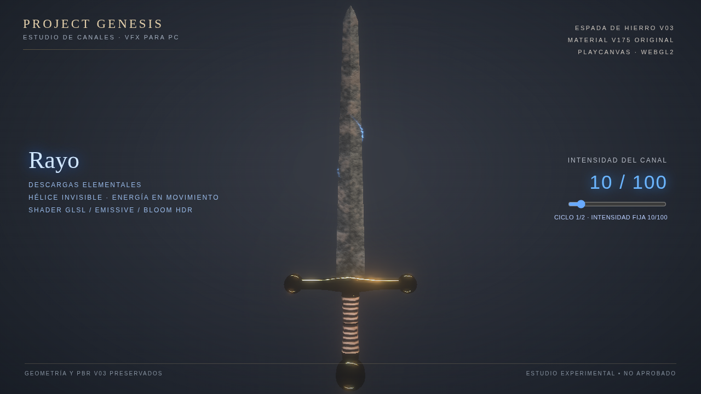
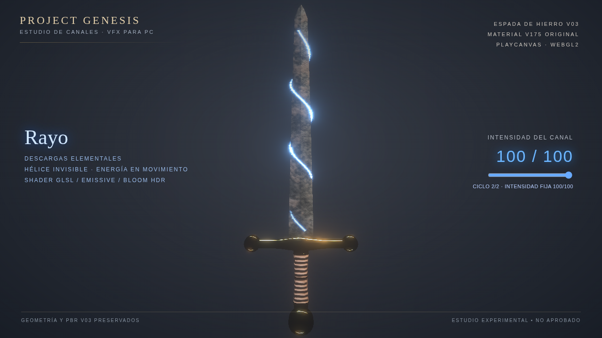

# Project Genesis — Rayo helicoidal · dos ciclos completos (V07)

**Prueba real PlayCanvas/WebGL2, experimental: no aprobada ni integrada en el juego.**

Este video NO muestra una barra de carga ni una subida progresiva de intensidad.
Muestra **dos recorridos completos e independientes** del rayo por la misma hélice tridimensional:

1. **Primer ciclo, 3 segundos:** intensidad constante **10/100**, el rayo recorre la hoja desde el principio al final.
2. **Segundo ciclo, 3 segundos:** intensidad constante **100/100**, el rayo repite el mismo recorrido por toda la hoja.

El valor de intensidad no cambia durante cada fase. Es la **descarga la que se mueve**, no una barra que se va llenando. Misma espada V03, mismo material V175, misma cámara, mismos shaders y geometría de hélice de V06.

## Animación completa, las dos intensidades

[Reproducir el MP4 completo](Genesis_Rayo_Ciclos_10_y_100_V007.mp4)

## Para mirar la hoja más grande desde el celular

[Reproducir MP4 con acercamiento](Genesis_Rayo_Ciclos_10_y_100_Zoom_V007.mp4)

## Dos fotogramas en la misma fase del recorrido

| 10/100 constante | 100/100 constante |
|:---:|:---:|
|  |  |

**Auditoría:** [audit.json](audit.json), 72 fotogramas, 12 FPS, 2 fases de 3 segundos, intensidad fija 10/100 y 100/100. La hélice de 3,15 vueltas es una guía invisible: solo se muestran tramos de energía que viajan por ella. El asset original no se modifica ni se redistribuye.
