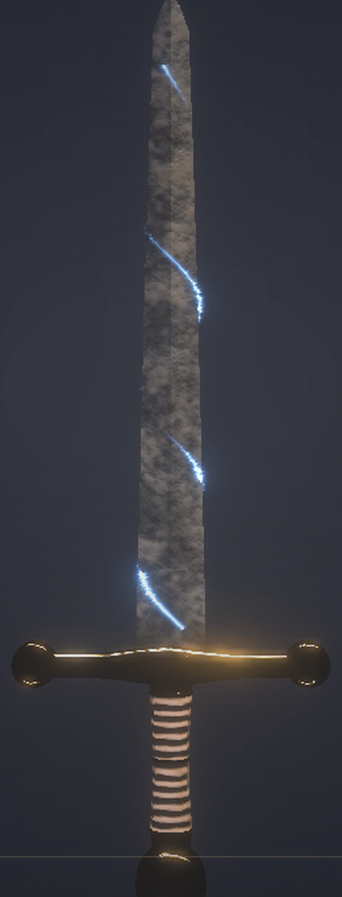
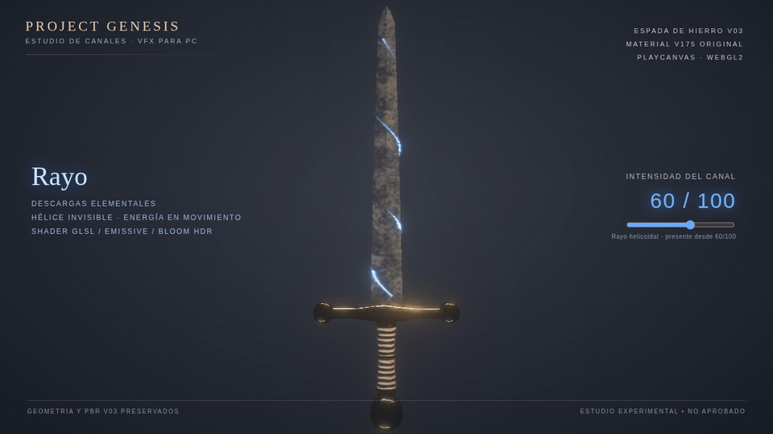
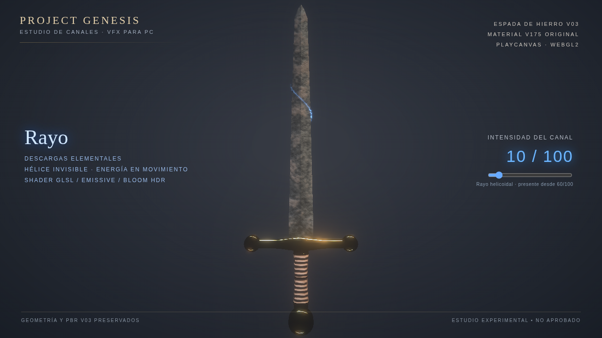
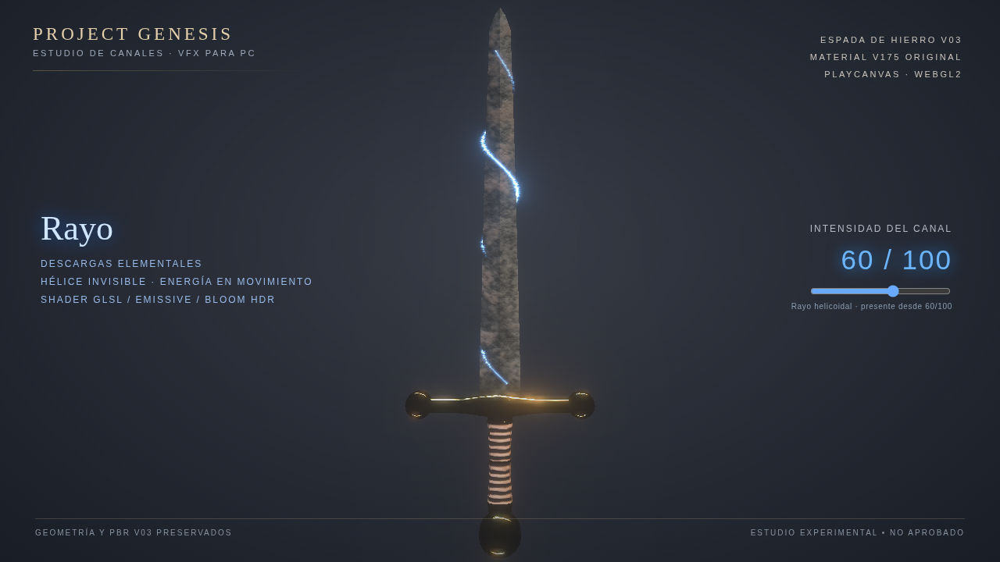
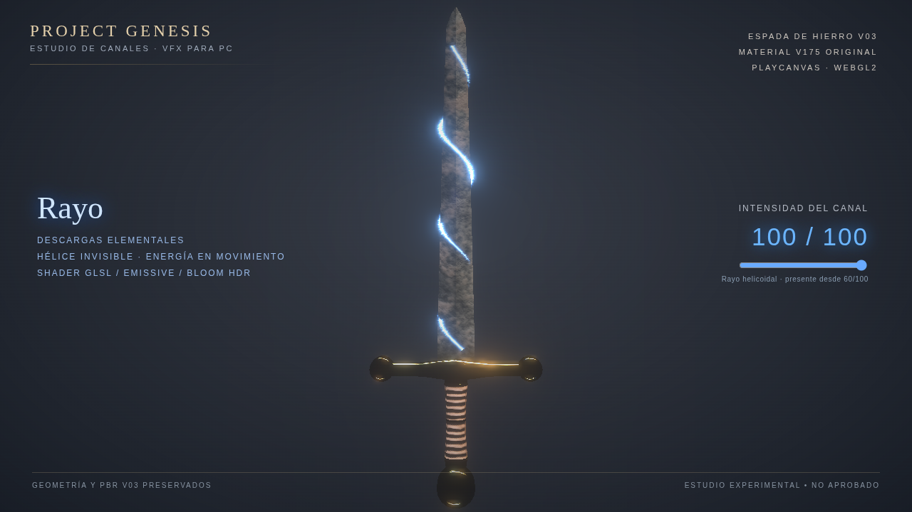

# Project Genesis — Rayo helicoidal V06 (experimental)

**Candidato de revisión visual; no aprobado ni integrado.** La espada original V03 (2.150 triángulos) y sus mapas V175 no se modifican.

## GIF ampliado — intensidad 60/100

[Ver video ampliado en MP4](Genesis_Rayo_Helice_Presencia_60_Closeup_V006.mp4)

## Animación completa

[Video 60/100 MP4](Genesis_Rayo_Helice_Presencia_60_V006.mp4) ·
[Animación de intensidad 0 a 100](Genesis_Rayo_Helice_0_a_100_V006.gif)

## Capturas

| 10/100 | 60/100 | 100/100 |
|:---:|:---:|:---:|
|  |  |  |

El resorte es solo una trayectoria 3D invisible; lo que se ve es la electricidad desplazándose junto a la hoja. 
La emisión y la duración de los tramos aumentan con la intensidad; no hay aura ni resplandor de empuñadura.

Consultar [audit.json](audit.json) para los datos de verificación real de PlayCanvas WebGL2. No reemplaza la evaluación visual del usuario.
