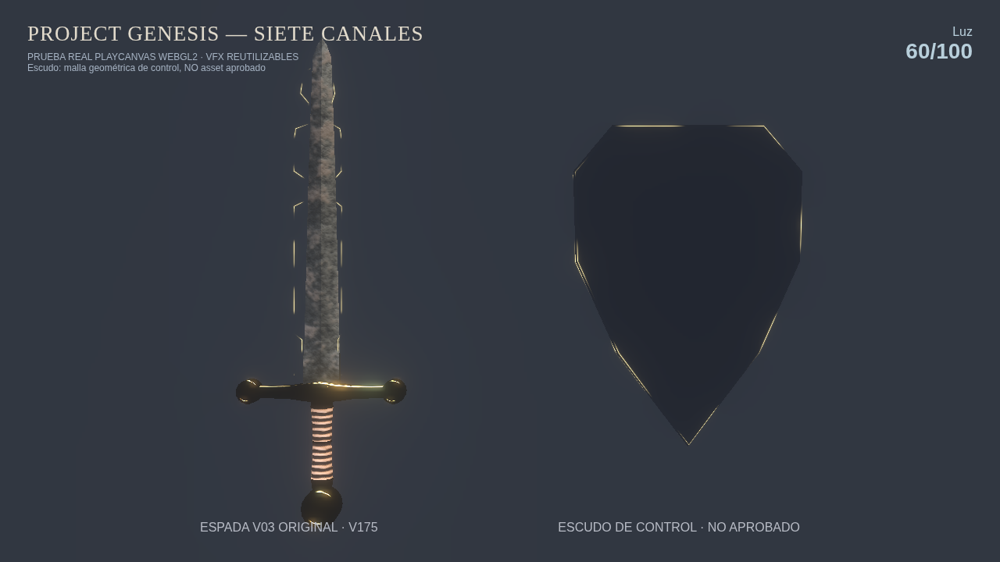
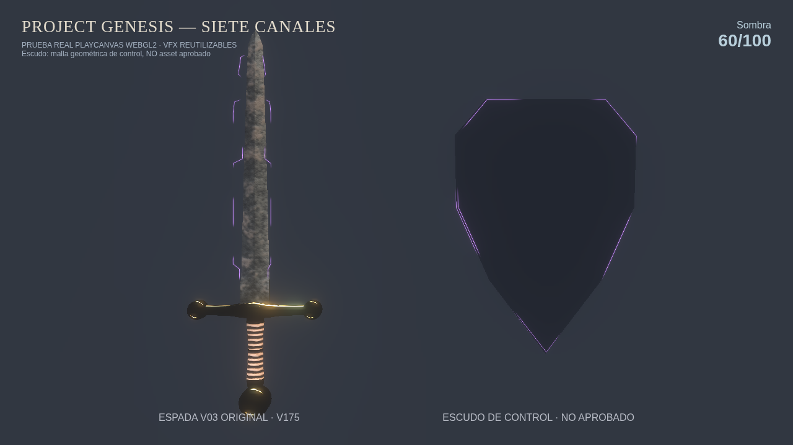
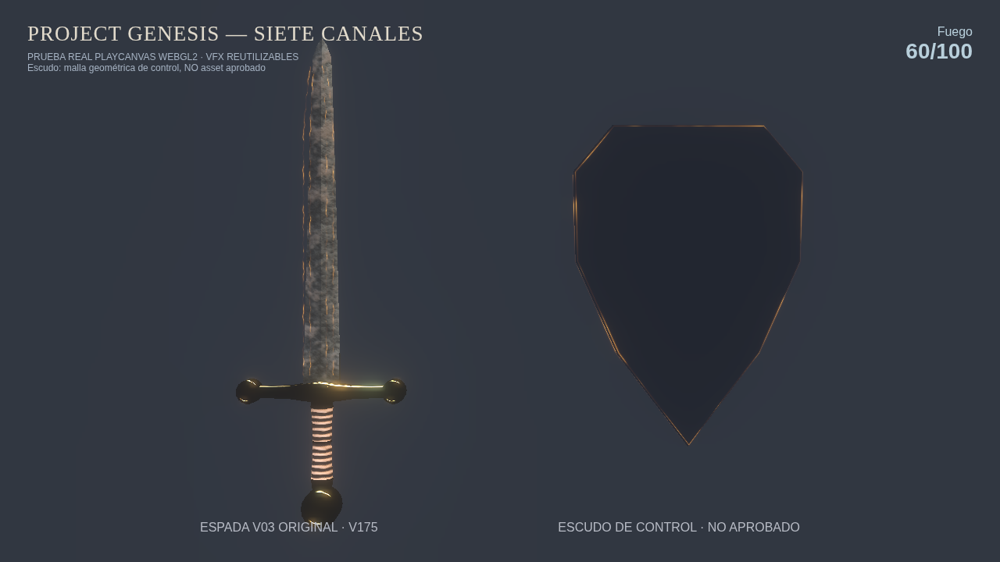
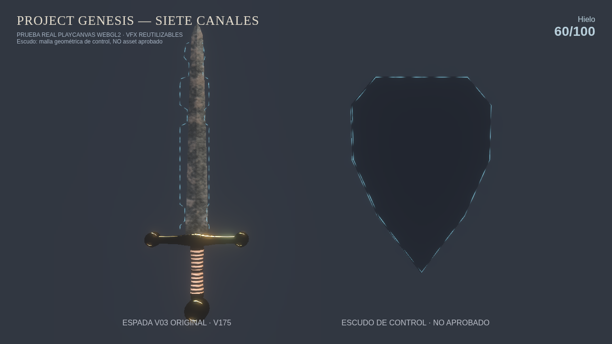
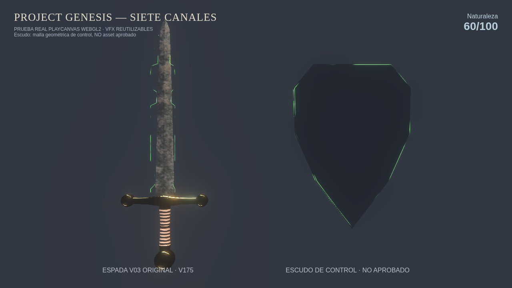
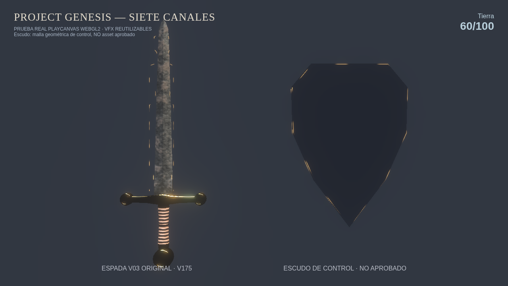
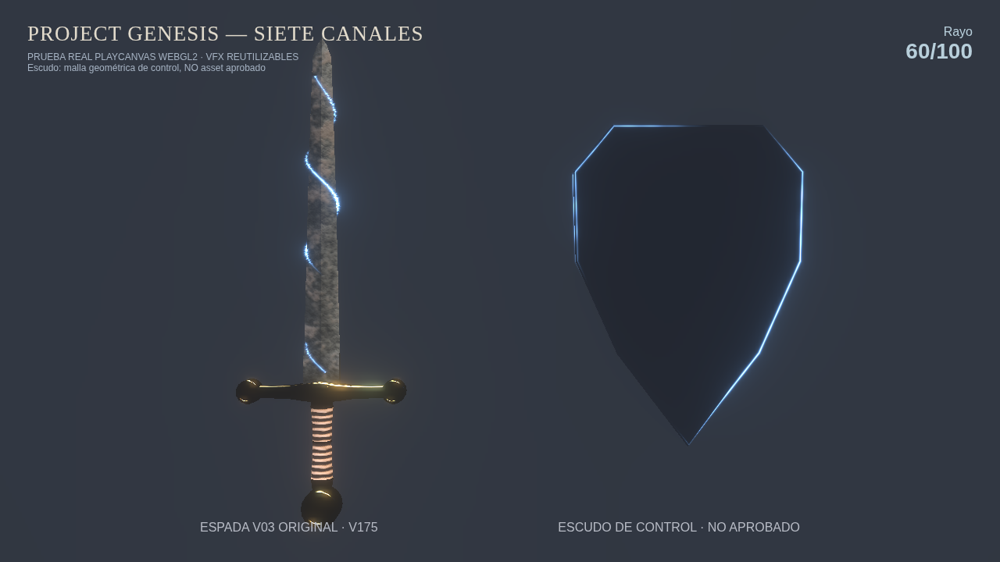
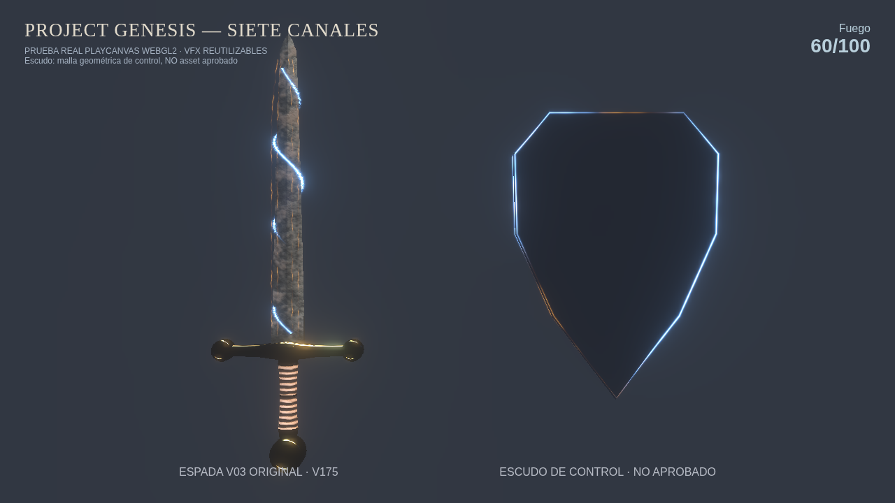

# Project Genesis — V09 · 7 shaders universales (prueba técnica)

**Estado: EXPERIMENTAL, no integrado.** Rayo V07 conserva su shader y geometría aprobados; Fuego V01 y los otros cinco canales siguen en evaluación.

## Siete canales elementales

| Canal | Espada V03 real + escudo de prueba, intensidad fija 60 |
|---|---|
| Luz |  |
| Sombra |  |
| Fuego |  |
| Hielo |  |
| Naturaleza |  |
| Tierra |  |
| Rayo |  |

## Combinación

**Importante:** La espada sí es la V03 original con V175, pero el escudo es una malla irregular **de control**: todavía no es el GLB real aprobado. Esta prueba comprueba que se obtiene su contorno desde sus propios vértices (no un círculo fijo ni una textura). Falta probar sobre el escudo definitivo y revisar el reverso en cámara.

Los siete canales son **Luz, Sombra, Fuego, Hielo, Naturaleza, Tierra y Rayo**. Base no es elemental; Veneno sigue siendo una técnica de Naturaleza, no una manifestación automática.

Material PBR y sombreado de efectos independientes. Este test es de comportamiento WebGL2, sin HDRI final; NO representa calidad final del hierro. Consultar [auditoría](audit.json) para cobertura real, compilación y fallos.
